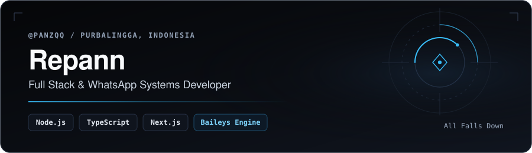
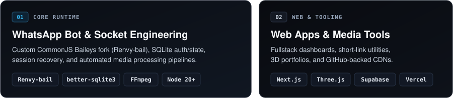

  

Building WhatsApp automation systems, custom socket engines, and fullstack Next.js web utilities from Indonesia.

[panpan.biz.id](https://panpan.biz.id) · [Portfolio](https://dev-panpan-portfolio.vercel.app)

---

### Focus Areas

  

### Selected Public Repositories

| Repository | Purpose | Stack | Live / Source |
| :--- | :--- | :--- | :--- |
| **[Renvy-bail](https://github.com/Panzqq/Renvy-bail)** | Modified CommonJS Baileys WhatsApp socket engine with RTC caller and session recovery fixes | JavaScript, Node.js | [Repository](https://github.com/Panzqq/Renvy-bail) |
| **[dev-panpan-portfolio](https://github.com/Panzqq/dev-panpan-portfolio)** | Personal developer portfolio with 3D scenes and motion transitions | Next.js, TypeScript, Three.js | [Live Site](https://dev-panpan-portfolio.vercel.app) |
| **[panpan-short-url](https://github.com/Panzqq/panpan-short-url)** | PanLink short URL generator, QR codes, click metrics, and media utilities | Next.js, TypeScript, Supabase | [Repository](https://github.com/Panzqq/panpan-short-url) |
| **[chatai](https://github.com/Panzqq/chatai)** | Fullstack AI chat web application backed by Next.js App Router and OpenAI SDK | Next.js, TypeScript, Framer Motion | [Repository](https://github.com/Panzqq/chatai) |
| **[panpan-uploader](https://github.com/Panzqq/panpan-uploader)** | Web uploader storing assets directly to GitHub with custom CDN links | HTML, JavaScript | [Repository](https://github.com/Panzqq/panpan-uploader) |
| **[renvy-ai-web](https://github.com/Panzqq/renvy-ai-web)** | Renvy AI web chat frontend template using Next.js App Router | Next.js, TypeScript | [Repository](https://github.com/Panzqq/renvy-ai-web) |

### Stack & Tooling

| Layer | Technologies |
| :--- | :--- |
| Runtime & Languages | JavaScript, TypeScript, Node.js (>=20), HTML, CSS |
| Frontend & Motion | Next.js, React, Tailwind CSS, Three.js, Framer Motion |
| Backend, Media & Deploy | Supabase, SQLite (`better-sqlite3`), FFmpeg, Sharp, Vercel |
